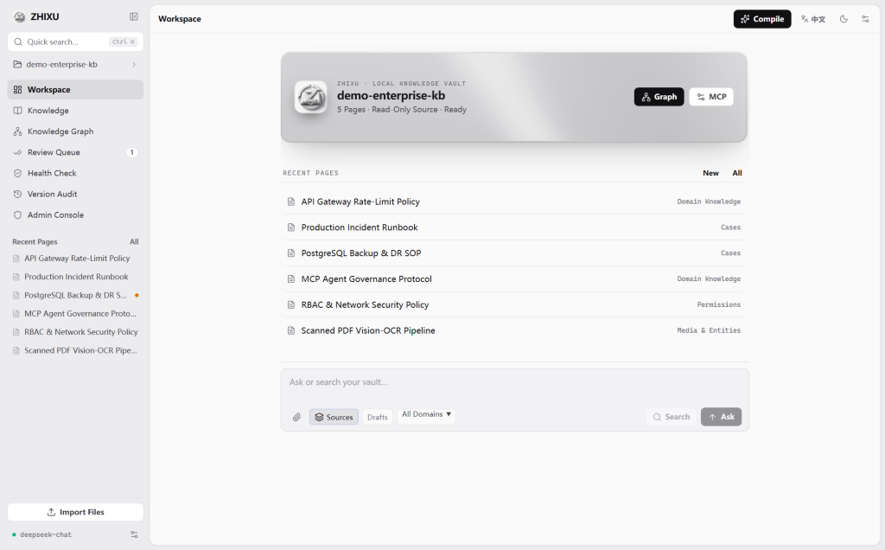
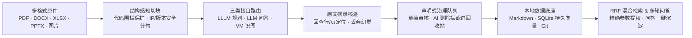

<div align="center">


<h1>知序 · ZHIXU</h1>

<p><strong>本地优先、可审阅、可溯源、可回滚的 AI 知识编译器与桌面工作台</strong></p>

<p>
  <a href="#界面预览">界面预览</a> ·
  <a href="#为什么是知序">为什么是知序</a> ·
  <a href="#架构与编译链路">架构链路</a> ·
  <a href="#核心能力">核心能力</a> ·
  <a href="#快速开始">快速开始</a> ·
  <a href="#部署与-api">部署与 API</a>
</p>

<p>
  
  
  
  
  
  
</p>

<br />



</div>

---

## 为什么是知序

大多数“本地 AI 知识库”只是把文档切片扔进向量库再套一层聊天框：问答难溯源、幻觉难发现、AI 改坏了没法退、人也没法改。

**知序（ZHIXU）定位为「AI 知识编译器」**——把散落的 PDF、Word、Excel、PPT 与图片自动编译为结构化、带原文摘录核验的本地 Markdown Wiki，所有 AI 变更都必须经过人工审阅，并保留完整的 Git 版本链。

| 对比维度 | 常规本地 RAG 工具 | 知序 · ZHIXU |
| :--- | :--- | :--- |
| **知识形态** | 隐式切片黑盒，人无法直接阅读维护 | **可读、可编辑的本地 Markdown Wiki**，自动维护双向链接与目录 |
| **防幻觉机制** | 模型自由发挥，无摘录校验 | **原文摘录自动回查定位**，未命中原文的摘录直接丢弃；证据不足诚实拒答 |
| **AI 变更安全** | 直接覆盖或删除旧内容 | **声明式审核流 + AI 删除拦截进回收站**，行级 Diff 对比，任意历史版本一键回滚 |
| **人机协同** | 纯只读，改错只能重跑模型 | **内置分栏 Markdown 编辑器** + 新建页面 + **问答一键沉淀为知识草稿** |
| **混合检索** | 单一向量或每次重建索引 | **RRF 多路融合**（BM25 + SQLite 持久向量 + 词边界 TF-IDF 互索引 + Sigmoid 精排） |
| **模型成本** | 所有任务硬塞同一个大模型 | **LLLM / LLM / VM 三类独立接口路由**，重推理、快问答、多模态各司其职 |
| **格式解析** | 常见缺少表格与演示文稿 | 原生支持 **PDF / DOCX / XLSX / PPTX / Markdown / HTML / 图片**（零重依赖 OOXML 解析） |

---

## 界面预览

<table>
  <tr>
    <td width="50%" align="center">
      
      <br />
      <strong>全屏商业登录页</strong> · 支持「晴空 / 暮光」壁纸与亮暗主题联动
    </td>
    <td width="50%" align="center">
      
      <br />
      <strong>三栏知识工作台</strong> · 分栏编辑 / 版本差异 / 原文依据检查器
    </td>
  </tr>
  <tr>
    <td width="50%" align="center">
      
      <br />
      <strong>全景系统控制中心</strong> · 三类 API 路由 / 防删回收站 / 多账号管理
    </td>
    <td width="50%" align="center">
      
      <br />
      <strong>多轮问答工作台</strong> · 上下文追问 / 命中高亮 / 一键沉淀草稿
    </td>
  </tr>
</table>

---

## 架构与编译链路



---

## 核心能力

### 1. 工业级文档解析与切块
- **零重依赖自研 OOXML 解析器**（`src/main/ooxml.ts`）：基于 Node 原生 `zlib`，Excel 按工作表转为标准 Markdown 表格（切块自动续接表头），PPT 按页提取正文与演讲者备注。
- **结构感知语义切块引擎**（`src/main/chunker.ts`）：状态机保护围栏代码块（代码内 `#` 注释不再误切为标题）、IP/版本号/小数安全分句（`192.168.1.100`、`v2.0`、`3.14` 保持完整）、过短碎片自动合块。

### 2. RRF 多路融合检索与多轮对话
- **持久化混合检索**（`src/main/search.ts`）：中文分词 BM25 + SQLite 持久化向量缓存（无 240 文档上限）+ 边界感知 TF-IDF 实体互索引（防止英文短词子串误匹配，自动归并括号别名如 `标准操作规程（SOP）`）+ IP/端口/数值精确提权。
- **自适应 Sigmoid 重排校准**（`src/main/model.ts`）：替换容易失真的线性 min-max，全不相关负 logit 不再被错误拉伸为满分。
- **多轮连续追问与知识沉淀**：自动结合近 3 轮上下文理解指代，证据片段自动高亮关键词，支持一键将优质回答带引用转存为知识草稿。

### 3. 可审阅、可编辑、可回滚的治理闭环
- **内置分栏 Markdown 编辑器**：支持实时预览、`Ctrl+S` 快捷保存、自动提取 `[[双向链接]]`、保存草稿（保留已发布基线做行级 Diff）或直接发布。
- **防删保护与原子写入**（`src/main/safe-write.ts`、`src/main/workflow.ts`）：AI 删除建议强制拦截至 `pending_delete` 待审队列，支持移入回收站、恢复或彻底清理；写入过程具备死进程锁自愈、Windows `EPERM/EBUSY` 退避重试与 `isomorphic-git` 版本留痕。
- **默认安全边界**：服务端默认监听 `127.0.0.1`、强制令牌或管理员会话鉴权、CORS 白名单、后台密码加盐 `scrypt` 哈希存储。

---

## 快速开始

> **环境要求**：Node.js `>= 22.13`（推荐 `24.x`，原生内置 `node:sqlite`）

### 桌面端本地运行

```bash
git clone https://github.com/JoeJiang-927117/Agentic-Knowledge-Base-.git
cd Agentic-Knowledge-Base-
npm install
npm run dev
```

- 默认初始化管理员账号：`zhixu` / `123456789`（可通过 `ZHIXU_ADMIN_USER` / `ZHIXU_ADMIN_PASSWORD` 覆盖，建议首次登录后在「系统后台 → 账号安全」修改）。
- 快捷键：`Ctrl + K` 唤起全局命令面板；编辑模式下 `Ctrl + S` 快速保存草稿。

### 类型检查、构建与自动化验证

```bash
npm run typecheck
npm run build
npm test
```

`npm test` 会运行全部 **14 项自动化验证**（结构切块、OOXML 解析、词边界互索引、Sigmoid 校准、死进程锁自愈、强制鉴权、三层路由、持久向量缓存、诚实引用、删除审批回收站及人工编辑器版本链）。

### 打包 Windows 客户端

```bash
npm run package:dir   # 免安装绿色版 -> release/win-unpacked/
npm run package       # NSIS 安装包 -> release/
```

---

## 部署与 API

### Docker Compose 一键启动服务端

```bash
ZHIXU_API_KEY=your-api-key \
ZHIXU_SERVER_TOKEN=your-strong-token \
ZHIXU_ADMIN_PASSWORD=your-strong-password \
docker compose up -d --build
```

### Node 独立服务端

```bash
ZHIXU_ROOT=/data/knowledge-base \
ZHIXU_API_KEY=your-api-key \
ZHIXU_SERVER_TOKEN=your-strong-token \
npm run server
```

<details>
<summary><strong>展开查看：完整环境变量清单</strong></summary>

| 变量 | 说明 | 默认值 |
| :--- | :--- | :--- |
| `ZHIXU_HOST` / `ZHIXU_PORT` | 服务端监听地址与端口 | `127.0.0.1` / `8787` |
| `ZHIXU_ROOT` | 知识库数据根目录 | `./data` |
| `ZHIXU_MODE` | 运行模式：`cloud`（外部 API 优先）/ `lan_gpu` / `local` | `cloud` |
| `ZHIXU_MODEL_BASE_URL` | 主模型网关地址（OpenAI 兼容） | `https://api.deepseek.com/v1` |
| `ZHIXU_API_KEY` | 默认共享 API Key | 空 |
| `ZHIXU_LLLM_MODEL` | LLLM 重推理模型（可选独立 `ZHIXU_LLLM_BASE_URL` / `ZHIXU_LLLM_API_KEY`） | `deepseek-reasoner` |
| `ZHIXU_LLM_MODEL` | LLM 标准问答模型（可选独立 `ZHIXU_LLM_BASE_URL` / `ZHIXU_LLM_API_KEY`） | `deepseek-chat` |
| `ZHIXU_VISION_MODEL` | VM 视觉多模态模型（可选独立 `ZHIXU_VM_BASE_URL` / `ZHIXU_VM_API_KEY`） | `qwen-vl-max` |
| `ZHIXU_EMBEDDING_MODEL` | 持久化向量 Embedding 模型 | `text-embedding-3-small` |
| `ZHIXU_RERANK_BASE_URL` / `ZHIXU_RERANK_MODEL` | 可选 Cross-Encoder 精排服务 | 空 |
| `ZHIXU_SERVER_TOKEN` | 服务端 Bearer 令牌（留空自动生成高强度随机令牌） | 自动生成 |
| `ZHIXU_CORS_ORIGIN` | 允许跨域来源白名单（逗号分隔） | 本机环回 |
| `ZHIXU_ADMIN_USER` / `ZHIXU_ADMIN_PASSWORD` | 初始超级管理员账密 | `zhixu` / `123456789` |

</details>

<details>
<summary><strong>展开查看：主要 HTTP API 接口</strong></summary>

所有受保护接口需携带 `Authorization: Bearer <TOKEN>`（服务端令牌或 `/api/auth/login` 返回的管理员会话令牌）：

| 方法与路径 | 说明 |
| :--- | :--- |
| `GET /api/v1/health` | 健康检查与鉴权状态 |
| `POST /api/auth/login` | 管理员登录换取会话令牌 |
| `GET /api/snapshot` | 获取工作区完整快照 |
| `POST /api/upload` | 上传原始资料（支持 Base64 JSON） |
| `POST /api/organize` | 触发增量扫描、切块与 Wiki 编译 |
| `POST /api/pages/save` | 人工新建或编辑 Wiki 页面（带版本快照与 Git 留痕） |
| `POST /api/workflow/transition` | 审核流转与删除审批（发布 / 退回 / 回收站 / 恢复） |
| `POST /api/v1/search` | RRF 多路混合检索 |
| `POST /api/v1/ask` | 多轮上下文溯源问答 |
| `GET /api/lint` / `POST /api/lint/fix` | 确定性知识体检与代码块安全断链修复 |

</details>

<details>
<summary><strong>展开查看：源码目录结构</strong></summary>

```text
.
├── assets/                          # 透明底应用图标 (zhixu-icon.png / icon.ico)
├── docs/screenshots/                # Demo 实景界面快照
├── src/
│   ├── main/
│   │   ├── index.ts                 # Electron 主进程与 IPC 路由
│   │   ├── store.ts                 # SQLite 索引、持久化向量表、Git 与版本快照
│   │   ├── wiki-engine.ts           # 两阶段知识提取、编译与原文摘录核验
│   │   ├── chunker.ts               # 结构感知语义切块引擎
│   │   ├── ooxml.ts                 # 零依赖 .xlsx / .pptx OOXML 解析器
│   │   ├── schema.ts                # 六域分类与边界感知 TF-IDF 互索引
│   │   ├── search.ts                # RRF 混合检索、多轮追问与诚实引用问答
│   │   ├── model.ts                 # LLLM / LLM / VM 三类接口与 Sigmoid 校准
│   │   ├── workflow.ts              # 声明式审核与防删状态机
│   │   ├── linter.ts                # 确定性知识体检与断链修复
│   │   ├── safe-write.ts            # 死进程自愈锁、原子写入与代码保护链接修复
│   │   └── admin-auth.ts            # 管理员认证、会话与多账号管理
│   ├── server/index.ts              # 独立 HTTP / SSE 服务端
│   ├── preload/index.ts             # Electron 安全预加载桥接
│   ├── shared/types.ts              # 前后端共享类型定义
│   └── renderer/                    # React 19 桌面端商业工作台
├── tests/
│   ├── verify_zhixu_core_upgrades.mjs
│   └── verify_zhixu_v2.mjs
├── Dockerfile
├── docker-compose.yml
└── package.json
```

</details>
