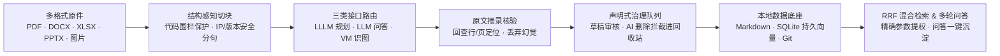

<div align="center">


<h1>知序 · ZHIXU</h1>

<p><strong>本地优先、可审阅、可溯源、可回滚的 AI 知识编译器与桌面工作台</strong></p>

<p>
  <a href="#项目简介">项目简介</a> ·
  <a href="#界面预览">界面预览</a> ·
  <a href="#为什么是知序">对比优势</a> ·
  <a href="#技术架构与原理">技术原理</a> ·
  <a href="#模型路由与推荐搭配">模型搭配</a> ·
  <a href="#快速开始">快速开始</a> ·
  <a href="#部署与-api">部署与 API</a>
</p>

<p>
  
  
  
  
  
  
</p>

<br />


</div>

---

## 项目简介

在日常研发、运维、项目管理与研究工作中，真正有价值的知识往往散落在海量异构文件里：几十页的规范 PDF、反复修订的 Word 规程、记录端口与阈值的 Excel 台账、汇报方案的 PPT，以及现场拍摄的设备或架构截图。

传统工具往往在两个极端之间摇摆：
- **纯手工 Wiki（Notion / Confluence / Obsidian）**：结构清晰、可控性强，但面对成百上千份存量资料时，人工归类、提炼和保持更新的维护成本极高，很快沦为“只进不出”的文档坟墓。
- **黑盒向量 RAG 工具**：上传即可问答，但知识被切碎在不可见的向量库中——回答究竟依据哪一段原文、是否存在前后版本冲突、模型有没有编造参数、更新资料后旧知识怎么修正，用户几乎完全失控。

**知序（ZHIXU）选择了一条更工程化的第三条路线——「AI 知识编译器」**：

1. **原始资料永不篡改**：所有导入的 PDF、DOCX、XLSX、PPTX、Markdown 与图片作为不可变原始证据本地落盘，按 SHA-256 哈希增量识别变化。
2. **AI 自动编译成可读 Wiki**：通过两阶段编译流水线（结构切块与要点提取 → 跨文档主题规划与合并），自动生成结构化 Markdown Wiki 页面、六大知识域分类与实体互索引网络，并将每条引用摘录自动回查原文行/页位置，无法核验的摘录直接丢弃。
3. **人机协同，所有变更可审、可证、可退**：AI 生成的新建、更新均先进入草稿审核队列，AI 提出的删除建议被强制拦截进入「待删审批 → 回收站」；同时内置分栏 Markdown 编辑器，人工随时可改、可新建、可对比已发布基线的行级 Diff，并依托 SQLite 版本快照与 `isomorphic-git` 实现任意历史版本回滚与一键撤销整理。
4. **开放的本地数据主权**：知识正文即标准 Markdown 文件，索引与持久化向量存于本地 SQLite，版本历史存于标准 `.git` 仓库。无云端锁定，既可作为单机桌面软件离线/接入外部 API 使用，也可通过自带独立服务端与 Docker 部署为团队局域网知识底座。

### 典型适用场景

- **研发与运维知识底座**：沉淀服务器台账（`.xlsx`）、巡检规程（`.docx`/`.pdf`）、排障脚本与事故复盘，利用精确 IP/端口/版本号提权检索快速定位处置方案。
- **制度、标准与合规资料库**：对准确度与审计要求极高的场景——强制人工审核发布、保留历史正式基线、问答严格标注适用条件与冲突缺口，杜绝“AI 偷偷改规范”。
- **项目经验与方案复盘**：将分散的立项文档、汇报 PPT（含演讲备注）与现场图片统一编译为可跳转的主题百科，支持多轮追问并将优质分析一键沉淀为正式草稿。
- **个人深度研究工作台**：兼顾 Obsidian 级别的本地 Markdown 自由度与多模态 AI 编译能力，通过 `Ctrl+K` 命令面板与分栏编辑实现高速阅读、改写与检索。

---

## 为什么是知序

| 对比维度 | 常规本地 RAG 工具 | 知序 · ZHIXU |
| :--- | :--- | :--- |
| **知识形态** | 隐式切片黑盒，人无法直接阅读维护 | **可读、可编辑的本地 Markdown Wiki**，自动维护双向链接与目录 |
| **防幻觉机制** | 模型自由发挥，无摘录校验 | **原文摘录自动回查定位**，未命中原文的摘录直接丢弃；证据不足诚实拒答 |
| **AI 变更安全** | 直接覆盖或删除旧内容 | **声明式审核流 + AI 删除拦截进回收站**，行级 Diff 对比，任意历史版本一键回滚 |
| **人机协同** | 纯只读，改错只能重跑模型 | **内置分栏 Markdown 编辑器** + 新建页面 + **问答一键沉淀为知识草稿** |
| **混合检索** | 单一向量或每次重建索引 | **RRF 多路融合**（BM25 + SQLite 持久向量 + 词边界 TF-IDF 互索引 + Sigmoid 精排） |
| **模型成本** | 所有任务硬塞同一个大模型 | **LLLM / LLM / VM 三类独立接口路由**，重推理、快问答、多模态各司其职 |
| **格式解析** | 常见缺少表格与演示文稿 | 原生支持 **PDF / DOCX / XLSX / PPTX / Markdown / HTML / 图片**（零重依赖 OOXML 解析） |

---

## 界面预览

<table>
  <tr>
    <td width="50%" align="center">
      
      <br />
      <strong>登录页</strong>
    </td>
    <td width="50%" align="center">
      
      <br />
      <strong>三栏知识工作台</strong> · 分栏编辑 / 版本差异 / 原文依据检查器
    </td>
  </tr>
  <tr>
    <td width="50%" align="center">
      
      <br />
      <strong>全景系统控制中心</strong> · 三类 API 路由 / 防删回收站 / 多账号管理
    </td>
    <td width="50%" align="center">
      
      <br />
      <strong>多轮问答工作台</strong> · 上下文追问 / 命中高亮 / 一键沉淀草稿
    </td>
  </tr>
</table>

---

## 技术架构与原理



### 1. 零重依赖文档解析与结构感知切块
- **自研 OOXML 解析器**（`src/main/ooxml.ts`）：基于 Node 原生 `zlib` 与纯 TypeScript ZIP 中央目录读取器实现，无需引入数十 MB 的重型第三方表格库。Excel 按工作表输出标准 Markdown 表格（切块时自动为每个切片续接表头），PPT 按幻灯片序号提取正文并自动合并演讲者备注。
- **结构感知语义切块引擎**（`src/main/chunker.ts`）：
  - **围栏代码块状态机**：精确追踪 ```` ``` ```` 与 `~~~` 区域，确保脚本中的 `# 注释` 或编号行绝不被误判为章节标题；超长代码块按行安全拆分并补全围栏标记。
  - **工程字面量安全分句**：保护 IP 地址（`192.168.1.100`）、版本号（`v2.0.1`）与小数（`3.14`）不被英文句点切碎。
  - **微块自动合并与内容去重**：同章节路径下的过短文本碎片自动合并，保留完整层级面包屑与行/页定位。

### 2. RRF 多路融合检索与诚实引用问答
- **四路融合排序**（`src/main/search.ts`、`src/main/schema.ts`）：
  1. **中文分词 BM25**：基于 `Intl.Segmenter('zh-CN')` + 二元切词的全文检索，内存索引按 `(root, revision, scope)` 缓存；
  2. **SQLite 持久化向量检索**：按文档内容哈希增量写入本地 `embeddings` 表，去除数量上限且避免重复计算；
  3. **边界感知 TF-IDF 互索引**：对英文/ASCII 实体强制词边界匹配（彻底消除 `port` 误命中 `import`/`report`），自动提取并归并括号别名（如 `标准操作规程（SOP）` → `SOP`），按 TF-IDF × 标题位置加权关联切块与 Wiki；
  4. **精确参数提权 + 自适应 Sigmoid 精排**：针对 IP、端口、版本号、带单位数值额外提权；Cross-Encoder 原始 logit 采用温度缩放 Logistic Sigmoid 校准（`1 / (1 + exp(-x / T))`），避免线性 min-max 把低相关候选误拉为满分。
- **多轮连续追问与证据高亮**：支持携带近 3 轮对话历史进行指代消解与上下文检索，命中证据自动高亮查询词；每条回答均输出「核心结论 / 适用条件 / 冲突与缺失 / 引用来源」，证据不足时明确拒答且绝不伪造引用。

### 3. 容错存储、版本治理与安全边界
- **崩溃自愈与原子写盘**（`src/main/safe-write.ts`）：写入锁文件记录进程 PID，异常崩溃遗留的死锁在毫秒级自动检测回收；Markdown 写入走「临时文件 → `fsync` → 原子重命名（Windows `EPERM/EBUSY` 退避重试）」。
- **代码块保护体检修复**（`src/main/linter.ts`）：自动巡检无依据页面、过期原件、断链、孤立页、重复标题、Schema 缺项与过薄内容；一键修复断链时严格跳过围栏代码与行内代码中的 `[[...]]`。
- **安全默认项**（`src/main/admin-auth.ts`、`src/server/index.ts`）：服务端默认绑定 `127.0.0.1`，未配置 Token 时自动生成强随机令牌强制鉴权；CORS 支持来源白名单；后台账号支持 `superadmin` / `reviewer` 分级，密码采用随机盐 `scrypt` + 常量时间比对。

---

## 模型路由与推荐搭配

知序采用**外部 API 优先**架构，同时支持局域网 GPU 服务（vLLM / SGLang / Ollama）与本机 Ollama，并把不同认知负载拆分到三类独立接口（可共享同一主网关，也可分别配置独立的 `Base URL` 与 `API Key`）：

| 接口层级 | 职责范围 | 云端外部 API 推荐 | 局域网 / 本机私有推荐 |
| :--- | :--- | :--- | :--- |
| **`LLLM`** | 全局 Wiki 结构规划、跨文档综合编译 | `deepseek-reasoner` / `qwen-max` / `o3-mini` | `Qwen3-32B` / `DeepSeek-R1-Distill-32B` |
| **`LLM`** | 日常多轮问答、单文档要点提取、引用核验 | `deepseek-chat` / `gpt-4o-mini` / `qwen-plus` | `Qwen3-14B` / `qwen2.5:14b` |
| **`VM`** | 现场照片、架构图、扫描图表多模态解析 | `qwen-vl-max` / `gpt-4o` | `qwen2.5vl:7b` / `Qwen2.5-VL-72B` |
| **`Embedding` / `Rerank`**（可选） | 持久化语义向量与精排打分 | `text-embedding-3-small` / `BAAI/bge-m3` | `bge-m3` + `bge-reranker-v2-m3` |

---

## 快速开始

> **环境要求**：Node.js `>= 22.13`（推荐 `24.x`，原生内置 `node:sqlite`）

### 桌面端本地运行

```bash
git clone https://github.com/JoeJiang-927117/Agentic-Knowledge-Base-.git
cd Agentic-Knowledge-Base-
npm install
npm run dev
```

- 默认初始化管理员账号：`zhixu` / `123456789`（可通过 `ZHIXU_ADMIN_USER` / `ZHIXU_ADMIN_PASSWORD` 覆盖，建议首次登录后在「系统后台 → 账号安全」修改密码）。
- 快捷键：`Ctrl + K` 唤起全局命令面板；编辑模式下 `Ctrl + S` 快速保存草稿。

### 类型检查、构建与自动化验证

```bash
npm run typecheck
npm run build
npm test
```

`npm test` 会运行全部 **14 项自动化验证**（结构切块、OOXML 解析、词边界互索引、Sigmoid 校准、死进程锁自愈、强制鉴权、三层路由、持久向量缓存、诚实引用、删除审批回收站及人工编辑器版本链）。

### 打包 Windows 客户端

```bash
npm run package:dir   # 免安装绿色版 -> release/win-unpacked/
npm run package       # NSIS 安装包 -> release/
```

---

## 部署与 API

### Docker Compose 一键启动服务端

```bash
ZHIXU_API_KEY=your-api-key \
ZHIXU_SERVER_TOKEN=your-strong-token \
ZHIXU_ADMIN_PASSWORD=your-strong-password \
docker compose up -d --build
```

### Node 独立服务端

```bash
ZHIXU_ROOT=/data/knowledge-base \
ZHIXU_API_KEY=your-api-key \
ZHIXU_SERVER_TOKEN=your-strong-token \
npm run server
```

<details>
<summary><strong>展开查看：完整环境变量清单</strong></summary>

| 变量 | 说明 | 默认值 |
| :--- | :--- | :--- |
| `ZHIXU_HOST` / `ZHIXU_PORT` | 服务端监听地址与端口 | `127.0.0.1` / `8787` |
| `ZHIXU_ROOT` | 知识库数据根目录 | `./data` |
| `ZHIXU_MODE` | 运行模式：`cloud`（外部 API 优先）/ `lan_gpu` / `local` | `cloud` |
| `ZHIXU_MODEL_BASE_URL` | 主模型网关地址（OpenAI 兼容） | `https://api.deepseek.com/v1` |
| `ZHIXU_API_KEY` | 默认共享 API Key | 空 |
| `ZHIXU_LLLM_MODEL` | LLLM 重推理模型（可选独立 `ZHIXU_LLLM_BASE_URL` / `ZHIXU_LLLM_API_KEY`） | `deepseek-reasoner` |
| `ZHIXU_LLM_MODEL` | LLM 标准问答模型（可选独立 `ZHIXU_LLM_BASE_URL` / `ZHIXU_LLM_API_KEY`） | `deepseek-chat` |
| `ZHIXU_VISION_MODEL` | VM 视觉多模态模型（可选独立 `ZHIXU_VM_BASE_URL` / `ZHIXU_VM_API_KEY`） | `qwen-vl-max` |
| `ZHIXU_EMBEDDING_MODEL` | 持久化向量 Embedding 模型 | `text-embedding-3-small` |
| `ZHIXU_RERANK_BASE_URL` / `ZHIXU_RERANK_MODEL` | 可选 Cross-Encoder 精排服务 | 空 |
| `ZHIXU_SERVER_TOKEN` | 服务端 Bearer 令牌（留空自动生成高强度随机令牌） | 自动生成 |
| `ZHIXU_CORS_ORIGIN` | 允许跨域来源白名单（逗号分隔） | 本机环回 |
| `ZHIXU_ADMIN_USER` / `ZHIXU_ADMIN_PASSWORD` | 初始超级管理员账密 | `zhixu` / `123456789` |

</details>

<details>
<summary><strong>展开查看：主要 HTTP API 接口</strong></summary>

所有受保护接口需携带 `Authorization: Bearer <TOKEN>`（服务端令牌或 `/api/auth/login` 返回的管理员会话令牌）：

| 方法与路径 | 说明 |
| :--- | :--- |
| `GET /api/v1/health` | 健康检查与鉴权状态 |
| `POST /api/auth/login` | 管理员登录换取会话令牌 |
| `GET /api/snapshot` | 获取工作区完整快照 |
| `POST /api/upload` | 上传原始资料（支持 Base64 JSON） |
| `POST /api/organize` | 触发增量扫描、切块与 Wiki 编译 |
| `POST /api/pages/save` | 人工新建或编辑 Wiki 页面（带版本快照与 Git 留痕） |
| `POST /api/workflow/transition` | 审核流转与删除审批（发布 / 退回 / 回收站 / 恢复） |
| `POST /api/v1/search` | RRF 多路混合检索 |
| `POST /api/v1/ask` | 多轮上下文溯源问答 |
| `GET /api/lint` / `POST /api/lint/fix` | 确定性知识体检与代码块安全断链修复 |

</details>

<details>
<summary><strong>展开查看：源码目录结构</strong></summary>

```text
.
├── assets/                          # 透明底应用图标 (zhixu-icon.png / icon.ico)
├── docs/screenshots/                # Demo 实景界面快照
├── src/
│   ├── main/
│   │   ├── index.ts                 # Electron 主进程与 IPC 路由
│   │   ├── store.ts                 # SQLite 索引、持久化向量表、Git 与版本快照
│   │   ├── wiki-engine.ts           # 两阶段知识提取、编译与原文摘录核验
│   │   ├── chunker.ts               # 结构感知语义切块引擎
│   │   ├── ooxml.ts                 # 零依赖 .xlsx / .pptx OOXML 解析器
│   │   ├── schema.ts                # 六域分类与边界感知 TF-IDF 互索引
│   │   ├── search.ts                # RRF 混合检索、多轮追问与诚实引用问答
│   │   ├── model.ts                 # LLLM / LLM / VM 三类接口与 Sigmoid 校准
│   │   ├── workflow.ts              # 声明式审核与防删状态机
│   │   ├── linter.ts                # 确定性知识体检与断链修复
│   │   ├── safe-write.ts            # 死进程自愈锁、原子写入与代码保护链接修复
│   │   └── admin-auth.ts            # 管理员认证、会话与多账号管理
│   ├── server/index.ts              # 独立 HTTP / SSE 服务端
│   ├── preload/index.ts             # Electron 安全预加载桥接
│   ├── shared/types.ts              # 前后端共享 TypeScript 类型定义
│   └── renderer/                    # React 19 桌面端商业工作台
├── tests/
│   ├── verify_zhixu_core_upgrades.mjs
│   └── verify_zhixu_v2.mjs
├── Dockerfile
├── docker-compose.yml
└── package.json
```

</details>

---

## 演进路线

- [x] 多格式原件解析（含零依赖 `.xlsx` / `.pptx`）与代码围栏安全切块
- [x] RRF 混合检索、SQLite 持久化向量缓存、词边界 TF-IDF 互索引与 Sigmoid 精排
- [x] 内置分栏 Markdown 编辑器、多轮连续追问与问答一键沉淀草稿
- [x] 声明式审核流、AI 删除审批拦截、回收站与 Git 版本链
- [ ] 页面级 RBAC 访问隔离与组织角色映射
- [ ] 扫描版 PDF 本地 OCR 与复杂多栏版面还原
- [ ] 检索召回率与引用忠实度自动化评估基准集
