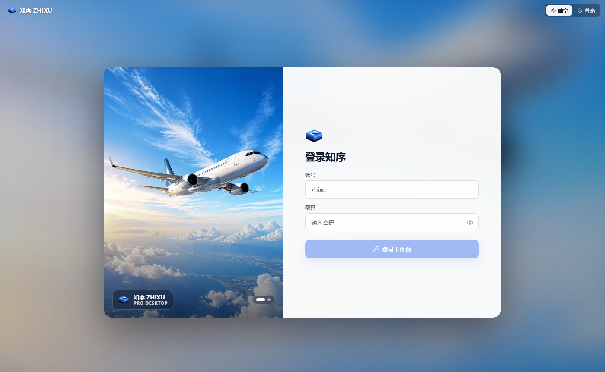
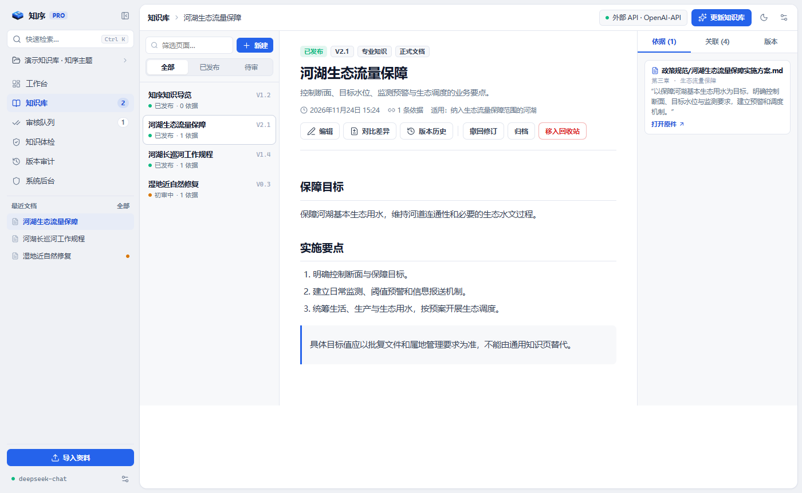
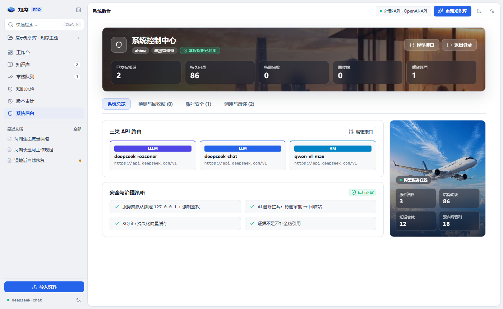

<p align="center">
  
</p>

<h1 align="center">知序 ZHIXU</h1>

<p align="center">
  本地优先、可审阅、可追溯、可回滚的 AI 知识编译与桌面工作台
</p>

<p align="center">
  
  
  
  
</p>

---

## 界面预览

### 商业登录页（支持「晴空 / 暮光」壁纸与主题切换）


### 问答工作台（多轮追问 · 三类接口路由 · 一键沉淀草稿）


### 三栏知识库工作台（内置分栏 Markdown 编辑 · 差异对比 · 依据追溯）


### 系统控制中心（全景后台 · 三层模型路由 · 防删审批与回收站）


---

## 核心特性

### 1. 证据驱动的知识编译链路
- **多格式原生解析**：支持 `PDF`、`DOCX`、`XLSX`（自研零依赖 OOXML 转 Markdown 表格）、`PPTX`（含演讲者备注）、`Markdown`、`TXT`、`HTML`、`CSV`、`JSON`、`YAML` 及图片资产。
- **结构感知切块引擎**（`src/main/chunker.ts`）：支持围栏代码块状态保护（不将代码内 `#` 注释误拆为标题）、IP/版本号/小数安全分句、超长表格表头续接、过短碎片自动并块。
- **原文摘录回查核验**：AI 生成的引用摘录会回查原始资料定位，无法核验的幻觉摘录自动丢弃。

### 2. 完整治理与版本链
- **声明式状态机**（`src/main/workflow.ts`）：`draft → moderating → validating → published → archived`，以及独立的 **AI 删除拦截审批流**（`pending_delete → deleted` 回收站 / 驳回恢复 / 彻底清理）。
- **内置分栏 Markdown 编辑器**：支持人工新建与编辑页面（实时预览、`Ctrl+S` 保存草稿或直接发布），自动保留已发布基线供行级差异对比与历史快照回滚。
- **原子 I/O 与 Git 留痕**（`src/main/safe-write.ts`）：临时文件写入 `fsync` 后原子替换（Windows `EPERM/EBUSY` 退避重试）、死进程锁自愈、`isomorphic-git` 历史留痕与一键撤销整理。

### 3. 混合检索与多轮问答
- **RRF 多路融合检索**（`src/main/search.ts`）：中文分词 BM25 + SQLite 持久化向量缓存（无文档数量上限）+ 边界感知 TF-IDF 实体互索引 + 精确数字/IP/端口提权 + 自适应 Sigmoid Reranker 校准。
- **多轮连续追问与一键沉淀**：问答工作台支持上下文连续追问、命中证据关键词高亮，以及将高质量回答一键转存为带来源引用的知识草稿。
- **诚实引用约束**：证据不足时明确拒答且不伪造补充引用；参考候选显式标注。

### 4. 三类模型接口路由与安全控制
- **外部 API 优先 + 三层独立路由**：
  - `LLLM`：重推理 / 长上下文模型（全局 Wiki 规划与跨文档综合）
  - `LLM`：标准文本模型（问答、要点提取与引用核验）
  - `VM`：视觉多模态模型（图片、图表与现场照片解析）
- **支持三种部署模式**：外部 OpenAI 兼容 API（默认）、局域网 GPU 服务（vLLM / SGLang / Ollama）、本机 Ollama。
- **服务端默认安全**：默认绑定 `127.0.0.1`、强制令牌/会话鉴权、CORS 白名单、后台账号采用加盐 `scrypt` 哈希存储。

---

## 项目结构

```text
.
├── assets/                     # 应用图标 (zhixu-icon.png / icon.ico)
├── src/
│   ├── main/
│   │   ├── index.ts            # Electron 主进程与 IPC 路由
│   │   ├── store.ts            # SQLite 索引、持久化向量表、Git 与版本快照
│   │   ├── wiki-engine.ts      # 两阶段知识提取、编译与摘录核验引擎
│   │   ├── chunker.ts          # 结构感知语义切块引擎
│   │   ├── ooxml.ts            # 零依赖 .xlsx / .pptx OOXML 解析器
│   │   ├── schema.ts           # 六域分类与边界感知 TF-IDF 互索引
│   │   ├── search.ts           # RRF 混合检索、多轮追问与诚实引用问答
│   │   ├── model.ts            # LLLM / LLM / VM 三类接口客户端与 Sigmoid 校准
│   │   ├── workflow.ts         # 声明式审核与防删状态机
│   │   ├── linter.ts           # 确定性知识体检与断链修复
│   │   ├── safe-write.ts       # 死进程自愈锁、原子写入与代码保护链接修复
│   │   └── admin-auth.ts       # 管理员认证、会话与多账号管理
│   ├── server/
│   │   └── index.ts            # 独立 HTTP / SSE 服务端（支持 Docker 部署）
│   ├── preload/                # Electron 安全预加载桥接
│   ├── shared/                 # 前后端共享 TypeScript 类型定义
│   └── renderer/               # React 19 桌面端商业工作台界面
├── tests/
│   ├── verify_zhixu_core_upgrades.mjs  # 核心引擎单元测试
│   └── verify_zhixu_v2.mjs             # 服务端鉴权、三层路由、防删与编辑端到端测试
├── Dockerfile
├── docker-compose.yml
└── package.json
```

---

## 快速开始

### 环境要求
- Node.js `>= 22.13`（推荐 `24.x`，使用内置 `node:sqlite`）

### 1. 安装依赖与本地开发

```bash
npm install
npm run dev
```

默认管理员初始化账号：`zhixu` / `123456789`（可通过环境变量 `ZHIXU_ADMIN_USER` / `ZHIXU_ADMIN_PASSWORD` 覆盖，建议首次登录后在「系统后台 → 账号安全」修改密码）。

### 2. 类型检查、构建与自动化测试

```bash
npm run typecheck
npm run build
npm test
```

测试套件涵盖 14 项核心校验：结构切块代码围栏保护、IP/版本号分句、`.xlsx`/`.pptx` 解析、词边界互索引、Sigmoid 重排校准、死进程锁自愈、默认鉴权拦截、三类模型路由、持久化向量缓存、诚实引用、删除审批/回收站及人工编辑器版本链。

### 3. 打包桌面端（Windows）

```bash
npm run package:dir   # 输出免安装目录至 release/win-unpacked/
npm run package       # 生成 NSIS 安装包
```

### 4. 独立服务端与 Docker 部署

```bash
# 直接运行 Node 服务端
ZHIXU_ROOT=/data/knowledge-base \
ZHIXU_API_KEY=your-api-key \
ZHIXU_SERVER_TOKEN=your-strong-token \
npm run server
```

或使用 Docker Compose：

```bash
ZHIXU_API_KEY=your-api-key \
ZHIXU_SERVER_TOKEN=your-strong-token \
ZHIXU_ADMIN_PASSWORD=your-strong-password \
docker compose up -d --build
```

---

## 常用环境变量

| 变量 | 说明 | 默认值 |
| --- | --- | --- |
| `ZHIXU_HOST` | 服务端监听地址 | `127.0.0.1` |
| `ZHIXU_PORT` | 服务端监听端口 | `8787` |
| `ZHIXU_ROOT` | 知识库数据目录 | `./data` |
| `ZHIXU_MODE` | 运行模式：`cloud` / `lan_gpu` / `local` | `cloud` |
| `ZHIXU_MODEL_BASE_URL` | 主模型网关地址 | `https://api.deepseek.com/v1` |
| `ZHIXU_API_KEY` | 默认共享 API Key | 空 |
| `ZHIXU_LLLM_MODEL` | LLLM 重推理模型（支持独立 `ZHIXU_LLLM_BASE_URL` / `ZHIXU_LLLM_API_KEY`） | `deepseek-reasoner` |
| `ZHIXU_LLM_MODEL` | LLM 标准问答模型（支持独立 `ZHIXU_LLM_BASE_URL` / `ZHIXU_LLM_API_KEY`） | `deepseek-chat` |
| `ZHIXU_VISION_MODEL` | VM 视觉多模态模型（支持独立 `ZHIXU_VM_BASE_URL` / `ZHIXU_VM_API_KEY`） | `qwen-vl-max` |
| `ZHIXU_EMBEDDING_MODEL` | 持久化向量 Embedding 模型 | `text-embedding-3-small` |
| `ZHIXU_RERANK_BASE_URL` / `ZHIXU_RERANK_MODEL` | 可选 Cross-Encoder 精排服务 | 空 |
| `ZHIXU_SERVER_TOKEN` | 服务端 Bearer Token（留空时自动生成强随机令牌） | 自动生成 |
| `ZHIXU_CORS_ORIGIN` | 允许的 CORS 来源白名单（逗号分隔） | 本机环回 |
| `ZHIXU_ADMIN_USER` / `ZHIXU_ADMIN_PASSWORD` | 初始超级管理员账号密码 | `zhixu` / `123456789` |

---

## 主要 HTTP API

所有受保护接口需携带 `Authorization: Bearer <TOKEN>`（服务端令牌或 `/api/auth/login` 返回的管理员会话令牌）：

| 方法与路径 | 用途 |
| --- | --- |
| `GET /api/v1/health` | 健康检查与鉴权状态 |
| `POST /api/auth/login` | 管理员登录获取会话令牌 |
| `GET /api/snapshot` | 获取工作区完整状态快照 |
| `POST /api/upload` | 上传原始资料文件 |
| `POST /api/organize` | 触发增量知识扫描与 Wiki 编译 |
| `POST /api/pages/save` | 人工新建或编辑 Wiki 页面（带版本快照与 Git 留痕） |
| `POST /api/workflow/transition` | 审核流转与删除审批（发布/退回/回收站/恢复） |
| `POST /api/v1/search` | RRF 混合检索 |
| `POST /api/v1/ask` | 带证据溯源与多轮上下文的问答 |
| `GET /api/lint` / `POST /api/lint/fix` | 确定性知识体检与断链自动修复 |
