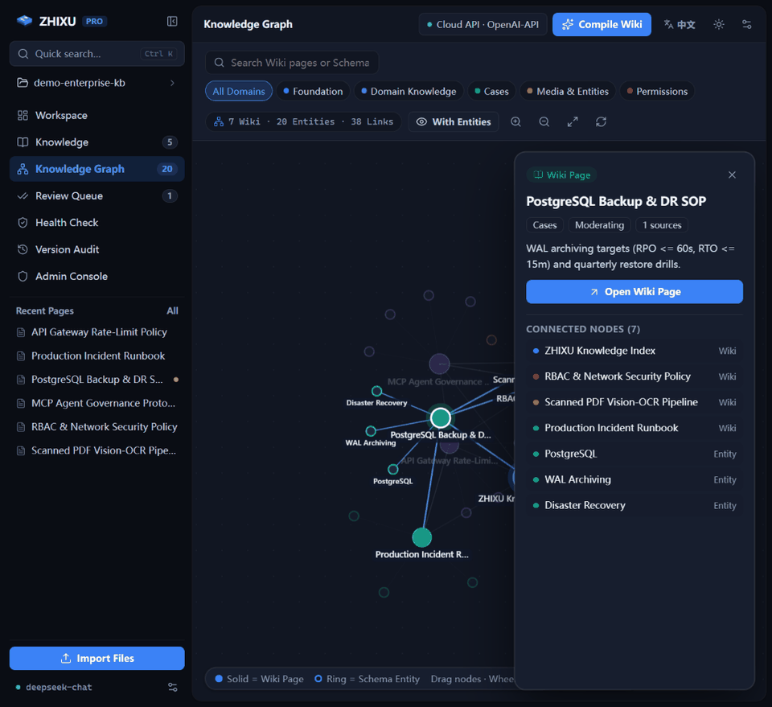
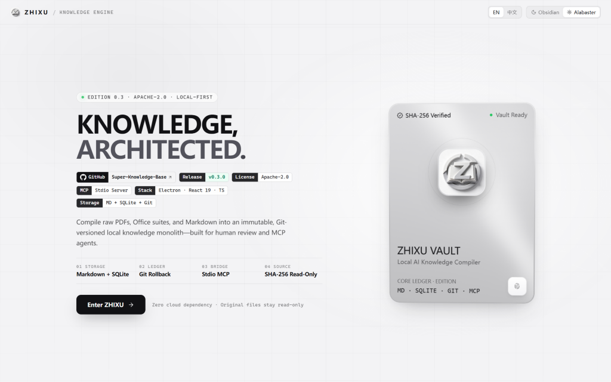
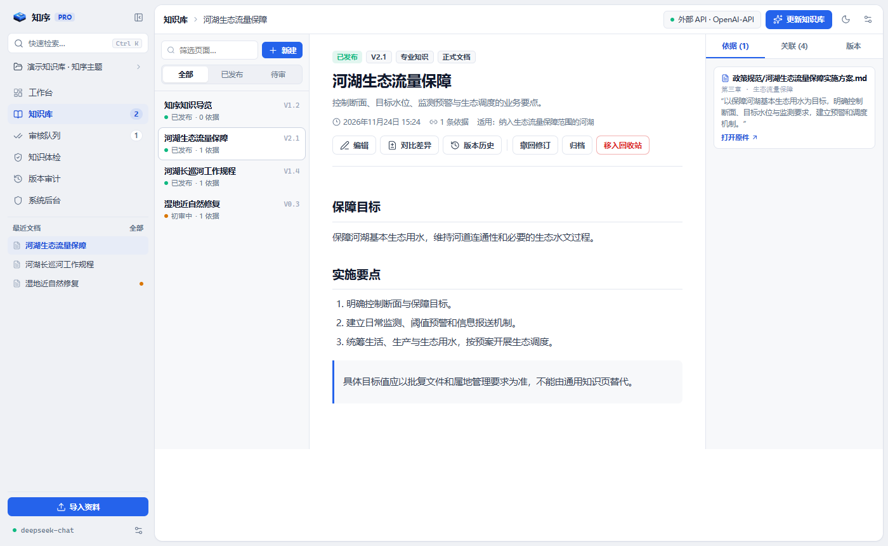
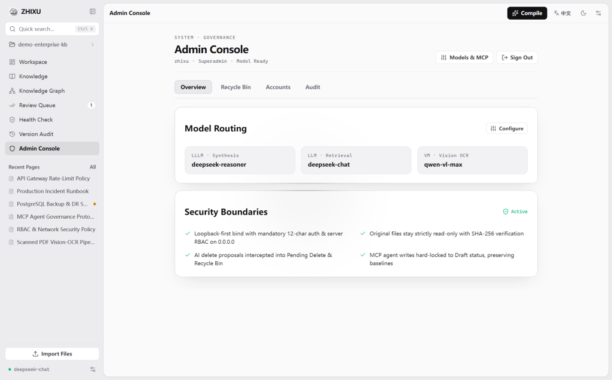
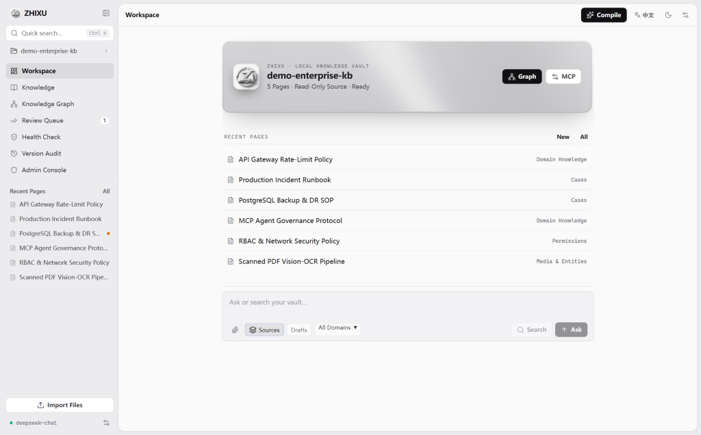
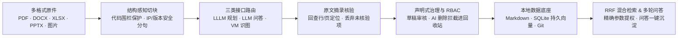

<div align="center">


<h1>知序 · ZHIXU</h1>

<p><strong>把散落的 PDF、Word、Excel、PPT 和 Markdown 丢进一个文件夹，自动编译为可审计的本地 Markdown 百科 + Git 版本链 + 严格溯源问答——无需 Docker、无需 ES、零云端依赖。</strong></p>

<p>
  <a href="./README.md">English</a> | <strong>简体中文</strong>
</p>

<p>
  <a href="https://joejiang-927117.github.io/zhixu/">
    
  </a>
  &nbsp;
  <a href="https://github.com/JoeJiang-927117/zhixu/releases/latest">
    
  </a>
</p>

<p>
  <a href="#项目简介">项目简介</a> ·
  <a href="#mcp-server-接入">MCP Server</a> ·
  <a href="#界面预览">界面预览</a> ·
  <a href="#架构与安全权限">架构与安全</a> ·
  <a href="#实测基准与已知限制">基准与限制</a> ·
  <a href="#模型路由与推荐搭配">模型搭配</a> ·
  <a href="#快速开始">快速开始</a> ·
  <a href="#部署与-api">部署与 API</a>
</p>

<p>
  <a href="https://github.com/JoeJiang-927117/zhixu/actions/workflows/ci.yml"></a>
  <a href="./LICENSE"></a>
  <a href="https://github.com/JoeJiang-927117/zhixu/releases/latest"></a>
  
  
  
  
  
  
  
</p>

<br />



</div>

---

## 项目简介

知序（ZHIXU）直接对标**企业级开源知识库架构**（如 RAGFlow、Dify、AnythingLLM、XWiki），聚焦企业落地 AI 知识库时最真实的工程痛点：**既要企业级的严谨治理、可审计与安全边界，又不想背负 Elasticsearch + MinIO + Redis + MySQL + 多容器编排的沉重运维负担**。

在研发、运维、制度合规、项目管理等企业业务中，核心知识高度分散在 PDF 规范、Word 规程、Excel 台账、PPT 汇报与现场图片之中。现有方案通常存在三类落差：
- **传统企业 Wiki（Confluence / XWiki / Outline）**：权限与流程成熟，但完全依赖人工整理，存量文档无法自动转化为结构化知识，长期维护成本极高。
- **重型企业 RAG 平台（RAGFlow / Dify）**：流水线功能齐全，但部署链路重、组件多、硬件门槛高，且以“切片向量检索”为主，缺乏面向正式制度与规程的「草稿审核 → 发布基线 → AI 删除拦截 → Git 回滚」治理闭环。
- **轻量本地问答工具（AnythingLLM 等）**：上手快，但偏向个人对话助手，缺少结构化 Wiki 编译、原文摘录回查核验、分栏人工修订与多级审批审计能力。

**知序采用「轻量单体、企业内核」的 AI 知识编译架构**：

1. **不可变证据底座**：所有导入的 PDF、DOCX、XLSX、PPTX、Markdown 与图片作为不可变原始凭证本地落盘，按 SHA-256 哈希增量识别变化，任何 AI 操作绝不改写原件。
2. **两阶段知识编译与摘录核验**：通过结构感知切块、零重依赖 OOXML 解析与两阶段模型编译，将异构资料自动沉淀为结构化 Markdown Wiki、六大知识域分类与 TF-IDF 实体互索引；所有引用摘录自动回查原文行/页定位，无法核验的幻觉内容直接剔除。
3. **企业级变更治理闭环**：AI 新增与更新全部先进入声明式审核流（`草稿 → 初审 → 终审 → 发布 → 归档`），AI 删除建议强制拦截进入「待删审批 → 回收站」；内置分栏 Markdown 编辑器支持人工随时修订与新建，每次变更均可对比已发布基线的行级 Diff，并依托 SQLite 版本快照与 `isomorphic-git` 实现任意版本回滚与一键撤销整理。
4. **开放数据主权与低成本交付**：知识正文即标准 Markdown，索引与持久化向量存于本地 SQLite，版本审计存于标准 `.git` 仓库。支持中英双语界面一键切换，单机可跑桌面客户端，内网/服务器通过单个 Node 进程或单容器 Docker 即可一键交付团队使用。

### 为什么选知序（横向对比）

| 核心能力 | 知序 ZHIXU | RAGFlow / Dify | AnythingLLM | Obsidian / XWiki |
| --- | --- | --- | --- | --- |
| **部署复杂度** | 单桌面应用或单 Node 进程（`SQLite + Git`） | 多容器编排（`ES + MinIO + Redis + MySQL`） | 单容器 / 桌面端 | 本地 / Java + 数据库 |
| **杂乱目录自动编译为结构化 Wiki** | 原生两阶段编译 + 原文行/页摘录回查 | 仅切片检索（无 Wiki 治理） | 侧重对话问答（无 Wiki 编译） | 需纯人工维护 |
| **原始文件严格只读不动** | SHA-256 追踪，绝不改写原件 | 切片入库 | 切片入库 | 直接编辑 |
| **变更治理与 AI 删除拦截** | `草稿 → 审核 → 发布` + `待删回收站` + Git 回滚 | 较弱 | 无 | XWiki 有 / Obsidian 无 |
| **本地 Ollama / 离线大模型** | 原生三层模型路由（`LLLM / LLM / VM` + 扫描版 PDF 视觉 OCR） | 支持 | 支持 | 依赖第三方插件 |
| **原生 MCP Server 与知识图谱** | 内置 `zhixu-mcp`（仅写草稿）+ 交互式 Canvas 知识图谱 | 需外部集成 | 较弱 | 依赖插件 |

## MCP Server 接入

知序内置零依赖标准 **Model Context Protocol (MCP)** 服务（`out/main/mcp.js`），可一键接入 **Claude Code、Cursor、Codex、Antigravity** 等 AI 编程客户端，让 Agent 在绝不改写原文件的前提下检索本地知识库并提交待审草稿：

```json
{
  "mcpServers": {
    "zhixu": {
      "command": "node",
      "args": ["/path/to/zhixu/out/main/mcp.js", "--root", "/path/to/your-knowledge-base"]
    }
  }
}
```

- **暴露工具**：`zhixu_search`、`zhixu_ask`、`zhixu_list_pages`、`zhixu_read_page`、`zhixu_get_graph` 及治理安全写入工具 `zhixu_propose_draft`（强制以草稿进入人工审核队列，绝不覆盖正式基线）。
- **暴露资源**：`zhixu://schema` 与 `zhixu://wiki/<slug>`。

### 典型企业落地场景

- **研发与运维知识底座**：沉淀服务器台账（`.xlsx`）、巡检规程（`.docx`/`.pdf`）、排障脚本与事故复盘，利用精确 IP/端口/版本号提权检索快速定位处置方案。
- **制度、标准与合规资料库**：对准确度与审计要求极高的场景——强制人工审核发布、保留历史正式基线、问答严格标注适用条件与冲突缺口，杜绝“AI 偷偷改规范”。
- **项目经验与方案复盘**：将分散的立项文档、汇报 PPT（含演讲备注）与现场图片统一编译为可跳转的主题百科，支持多轮追问并将优质分析一键沉淀为正式草稿。
- **专网 / 局域网私有部署**：默认外部 API 优先，也可无缝切换局域网 GPU（vLLM / SGLang / Ollama）或本机 Ollama，配合强制令牌鉴权与 `127.0.0.1` 默认绑定满足内网安全基线。

---

## 与企业级开源知识库架构对比

| 架构维度 | 重型开源 RAG 平台<br/>（如 RAGFlow / Dify） | 轻量本地 AI 助手<br/>（如 AnythingLLM） | 传统企业 Wiki<br/>（如 XWiki / Outline） | 知序 · ZHIXU |
| :--- | :--- | :--- | :--- | :--- |
| **核心定位** | 通用多租户 RAG 编排平台 | 个人/小团队本地对话与 Agent | 人工协作文档与知识门户 | **轻量级企业 AI 知识编译器与治理工作台** |
| **部署复杂度** | 高（常需 ES / DB / 对象存储 / Redis 多容器） | 低（单桌面或单容器） | 中（需数据库与 Web 服务） | **极低（桌面端或单进程 / 单容器 Docker）** |
| **知识产出形态** | 向量切片为主，人难直接维护 | 向量切片与聊天记录 | 人工编写页面 | **自动编译 + 人工可编辑的标准 Markdown Wiki** |
| **防幻觉与核验** | 依赖重排与提示词约束 | 依赖基础相似度召回 | 人工编写 | **原文摘录强制回查定位 + 证据不足诚实拒答** |
| **AI 变更治理** | 缺少页面级审批与删除拦截 | 无审核流与版本基线 | 有流程但无 AI 编译能力 | **声明式审核流 + AI 删除拦截回收站 + 行级 Diff + Git 回滚** |
| **模型算力分工** | 偏统一模型配置 | 单一聊天/嵌入模型 | 无 | **LLLM / LLM / VM 三层独立接口按任务分流** |
| **数据开放性** | 深度耦合内部数据库与对象存储 | 耦合内部向量库 | 耦合平台数据库 | **100% 开放本地文件（Markdown + SQLite + Git）** |

---

## 界面预览

<table>
  <tr>
    <td width="50%" align="center">
      
      <br />
      <strong>登录页</strong>
    </td>
    <td width="50%" align="center">
      
      <br />
      <strong>三栏知识工作台</strong> · 分栏编辑 / 版本差异 / 原文依据检查器
    </td>
  </tr>
  <tr>
    <td width="50%" align="center">
      
      <br />
      <strong>全景系统控制中心</strong> · 三类 API 路由 / 防删回收站 / 多账号管理
    </td>
    <td width="50%" align="center">
      
      <br />
      <strong>多轮问答工作台</strong> · 上下文追问 / 命中高亮 / 一键沉淀草稿
    </td>
  </tr>
</table>

---

## 架构与安全权限



### 1. 文档解析与结构感知切块
- **零重依赖 OOXML 解析器**（`src/main/ooxml.ts`）：基于 Node 原生 `zlib` 与纯 TypeScript ZIP 中央目录读取器实现，Excel 跨切片自动续接表头，PPT 自动合并演讲者备注。
- **结构感知切块引擎**（`src/main/chunker.ts`）：围栏代码块状态机（```` ``` ```` / `~~~`）、IP/版本号/小数安全分句、微块合并与行/页定位。

### 2. RRF 混合检索与原文摘录核验
- **四路融合排序**（`src/main/search.ts`、`src/main/schema.ts`）：中英文停用词过滤 + `Intl.Segmenter` BM25、SQLite 持久化向量缓存、ASCII 词边界 TF-IDF 互索引、精确技术参数提权与温度缩放 Logistic Sigmoid 精排校准。

### 3. 安全基线与服务端 RBAC 权限矩阵
- **移除通用默认密码**（`src/main/admin-auth.ts`）：
  - 密码最低长度提升至 **12 位**（拒绝弱口令与旧默认密码，随机盐 `scrypt` + `timingSafeEqual`）。
  - 桌面端/本机环回首次启动强制引导初始化超级管理员密码（`/api/auth/setup`）。
  - 非本机监听（如 Docker `0.0.0.0`）未提供强 `ZHIXU_ADMIN_PASSWORD`（≥12 位）或检测到旧弱口令时**直接拒绝启动**。
  - 登录接口按 IP / 账号限流，支持渐进延迟、连续失败锁定（返回 `HTTP 429` + `Retry-After`）与结构化失败日志。
- **统一服务端 RBAC 与权威会话身份**（`src/main/rbac.ts`、`src/server/index.ts`）：
  - 所有操作人（`reviewedBy` / `createdBy`）一律取服务端会话身份，忽略客户端传入的 `reviewer` / `author`。
  - `/api/source` 与 `/api/remove-source` 拦截路径穿越与 `.localwiki/`、`.git/` 等隐藏路径。

| 角色 | 允许操作 | 拦截操作（返回 `403 Forbidden`） |
| :--- | :--- | :--- |
| **`reviewer`（审核员）** | 检索、问答、反馈、查看页面/差异/版本/体检、新建编辑草稿、提交初审/终审、审批发布、驳回删除 | 模型接口配置、上传/删除资料、触发/取消/撤销整理、自动修复断链、批量全部发布、版本回滚、确认移入回收站、恢复回收站、彻底清理、账号增删 |
| **`superadmin`（超级管理员）** | 全部 `reviewer` 权限 + 高危管理与系统配置操作 | 无 |

---

## 实测基准与已知限制

执行 `npm run build && npm run eval` 可复现端到端固定语料基准（`tests/eval_benchmark.mjs`，直连编译后的 `out/main/server.js`，测试确定性检索、原文核验、拒答与备份恢复链路）：

| 评估指标 | 实测结果 | 测试条件说明 |
| :--- | :--- | :--- |
| **固定语料规模** | 7 篇 Markdown 规范 + 1 份 `.xlsx` | 15 条可回答技术/制度问题 + 5 条无依据越界问题 |
| **Recall@1 / @3 / @5** | **100.0% / 100.0% / 100.0%** | 端到端 `POST /api/v1/search` |
| **MRR** | **1.000** | 可回答问题集 |
| **原文摘录一致率** | **100.0% (7 / 7)** | 已发布页面引用回查不可变原件 |
| **无依据问题拒答/低分拦截率** | **100.0% (5 / 5)** | 越界查询无高分误召回（`< 0.25`） |
| **HTTP 检索延迟（p50 / p95）** | **15.4 ms / 16.3 ms** | 本机环回 Node 24（`out/main/server.js`） |
| **进程内存占用（RSS）** | **63.8 MB** | 单节点 SQLite + 内存 Orama 索引 |
| **冷备份恢复与会话过期** | **PASS** | 目录拷贝重启可正常检索；过期令牌返回 `401` |

### 已知限制
- **真实模型评测差异**：CI 自动化测试覆盖确定性检索、权限/安全边界与 Mock 模型路由；真实环境下的总结与问答质量仍取决于所接入的 `LLLM` / `LLM` / `Embedding` / `Rerank` 模型能力。
- **纯图片扫描版 PDF**：带文本层 PDF 通过 `pdfjs-dist` 直接解析，无文本层的纯扫描图片 PDF 需后续接入 OCR。
- **单节点存储边界**：SQLite + 本地文件系统 + Git 面向单机与部门级部署，不面向多区域水平分片集群。
- **Windows 证书性质**：仓库内 `certs/zhixu-codesign.cer` 为**自签名证书**，并非公共商业 CA 颁发。

---

## 模型路由与推荐搭配

知序采用**外部 API 优先**架构，同时支持局域网 GPU 服务（vLLM / SGLang / Ollama）与本机 Ollama，并把不同认知负载拆分到三类独立接口（可共享同一主网关，也可分别配置独立的 `Base URL` 与 `API Key`）：

| 接口层级 | 职责范围 | 云端外部 API 推荐 | 局域网 / 本机私有推荐 |
| :--- | :--- | :--- | :--- |
| **`LLLM`** | 全局 Wiki 结构规划、跨文档综合编译 | `deepseek-reasoner` / `qwen-max` / `o3-mini` | `Qwen3-32B` / `DeepSeek-R1-Distill-32B` |
| **`LLM`** | 日常多轮问答、单文档要点提取、引用核验 | `deepseek-chat` / `gpt-4o-mini` / `qwen-plus` | `Qwen3-14B` / `qwen2.5:14b` |
| **`VM`** | 现场照片、架构图、扫描图表多模态解析 | `qwen-vl-max` / `gpt-4o` | `qwen2.5vl:7b` / `Qwen2.5-VL-72B` |
| **`Embedding` / `Rerank`**（可选） | 持久化语义向量与精排打分 | `text-embedding-3-small` / `BAAI/bge-m3` | `bge-m3` + `bge-reranker-v2-m3` |

---

## 快速开始

> [!IMPORTANT]
> **首次启动安全策略**：不再提供通用默认密码。桌面端或本机环回首次启动时会引导设置超级管理员密码（至少 **12 位**）；非本机监听（如 Docker `0.0.0.0`）未设置强密码环境变量 `ZHIXU_ADMIN_PASSWORD` 时将拒绝启动。

> **环境要求**：Node.js `>= 22.13`（推荐 `24.x`，原生内置 `node:sqlite`）

### 桌面端本地运行

```bash
git clone https://github.com/JoeJiang-927117/zhixu.git
cd ZHIXUAgentic-Knowledge-Base
npm install
npm run dev
```

- 国内网络安装 Electron 可选设置 `ELECTRON_MIRROR=https://npmmirror.com/mirrors/electron/`。
- 快捷键：`Ctrl + K` 唤起全局命令面板；编辑模式下 `Ctrl + S` 快速保存草稿。

### 类型检查、安全测试与检索基准

```bash
npm run typecheck
npm run build
npm test          # 核心单元测试 + 服务端安全/RBAC/限流测试 + 固定语料检索基准
npm run eval      # 单独运行固定语料端到端评测基准
```

### 打包 Windows 客户端

```bash
npm run package:dir   # 免安装绿色版 -> release/win-unpacked/
npm run package       # NSIS 安装包 -> release/
```

---

## 部署与 API

### Docker Compose 一键启动服务端

复制 `.env.example` 为 `.env`，填写强密码 `ZHIXU_ADMIN_PASSWORD`（≥12 位）与 `ZHIXU_API_KEY` 后启动：

```bash
cp .env.example .env
# 编辑 .env，设置 ZHIXU_ADMIN_PASSWORD（至少 12 位）与 ZHIXU_API_KEY
docker compose up -d --build
```

### Node 独立服务端

```bash
ZHIXU_ROOT=/data/knowledge-base \
ZHIXU_API_KEY=your-api-key \
ZHIXU_SERVER_TOKEN=your-strong-token \
ZHIXU_ADMIN_PASSWORD=YourStrongPassword#2026 \
npm run server
```

<details>
<summary><strong>展开查看：完整环境变量清单</strong></summary>

| 变量 | 说明 | 默认值 |
| :--- | :--- | :--- |
| `ZHIXU_HOST` / `ZHIXU_PORT` | 服务端监听地址与端口 | `127.0.0.1` / `8787` |
| `ZHIXU_ROOT` | Node 进程 / Docker 容器内知识库根目录 | `./data`（Docker 内为 `/data/knowledge-base`） |
| `ZHIXU_HOST_DATA_DIR` | Docker Compose 宿主机挂载目录（兼容旧名 `ZHIXU_DATA_DIR`） | `./data` |
| `ZHIXU_MODE` | 运行模式：`cloud`（外部 API 优先）/ `lan_gpu` / `local` | `cloud` |
| `ZHIXU_MODEL_BASE_URL` | 主模型网关地址（OpenAI 兼容） | `https://api.deepseek.com/v1` |
| `ZHIXU_API_KEY` | 默认共享 API Key | 空 |
| `ZHIXU_LLLM_MODEL` | LLLM 重推理模型（可选独立 `ZHIXU_LLLM_BASE_URL` / `ZHIXU_LLLM_API_KEY`） | `deepseek-reasoner` |
| `ZHIXU_LLM_MODEL` | LLM 标准问答模型（可选独立 `ZHIXU_LLM_BASE_URL` / `ZHIXU_LLM_API_KEY`） | `deepseek-chat` |
| `ZHIXU_VISION_MODEL` | VM 视觉多模态模型（可选独立 `ZHIXU_VM_BASE_URL` / `ZHIXU_VM_API_KEY`） | `qwen-vl-max` |
| `ZHIXU_EMBEDDING_MODEL` | 持久化向量 Embedding 模型 | `text-embedding-3-small` |
| `ZHIXU_RERANK_BASE_URL` / `ZHIXU_RERANK_MODEL` | 可选 Cross-Encoder 精排服务 | 空 |
| `ZHIXU_SERVER_TOKEN` | 服务端 Bearer 令牌（留空自动生成高强度随机令牌） | 自动生成 |
| `ZHIXU_CORS_ORIGIN` | 允许跨域来源白名单（逗号分隔） | 本机环回 |
| `ZHIXU_ADMIN_USER` / `ZHIXU_ADMIN_PASSWORD` | 初始超级管理员账密（≥12 位，非本机监听必填） | `zhixu` / 本机首次启动交互设置 |

</details>

<details>
<summary><strong>展开查看：主要 HTTP API 接口</strong></summary>

所有受保护接口需携带 `Authorization: Bearer <TOKEN>`（服务端令牌或 `/api/auth/login` 返回的管理员会话令牌）：

| 方法与路径 | 说明 |
| :--- | :--- |
| `GET /api/v1/health` | 健康检查与鉴权状态 |
| `POST /api/auth/login` | 管理员登录换取会话令牌 |
| `GET /api/snapshot` | 获取工作区完整快照 |
| `POST /api/upload` | 上传原始资料（支持 Base64 JSON） |
| `POST /api/organize` | 触发增量扫描、切块与 Wiki 编译 |
| `POST /api/pages/save` | 人工新建或编辑 Wiki 页面（带版本快照与 Git 留痕） |
| `POST /api/workflow/transition` | 审核流转与删除审批（发布 / 退回 / 回收站 / 恢复） |
| `POST /api/v1/search` | RRF 多路混合检索 |
| `POST /api/v1/ask` | 多轮上下文溯源问答 |
| `GET /api/lint` / `POST /api/lint/fix` | 确定性知识体检与代码块安全断链修复 |

</details>

---

## 演进路线

- [x] 多格式原件解析（含零依赖 `.xlsx` / `.pptx`）与代码围栏安全切块
- [x] RRF 混合检索、SQLite 持久化向量缓存、词边界 TF-IDF 互索引与 Sigmoid 精排
- [x] 内置分栏 Markdown 编辑器、多轮连续追问、问答一键沉淀草稿与中英双语界面
- [x] 声明式审核流、AI 删除审批拦截、回收站与 Git 版本链
- [ ] 页面级 RBAC 访问隔离与组织角色映射
- [ ] 扫描版 PDF 本地 OCR 与复杂多栏版面还原
- [ ] 检索召回率与引用忠实度自动化评估基准集

---

## 开源许可与 Windows 自签名证书

- **开源协议**：本项目基于 **[Apache License 2.0](./LICENSE)** 开源（可商用、支持二次开发，含专利授权；分发修改版请保留 [LICENSE](./LICENSE) 与 [NOTICE](./NOTICE) 声明）。
- **第三方许可**：依赖组件开源协议清单见 [THIRD_PARTY_LICENSES.md](./THIRD_PARTY_LICENSES.md)。
- **安全策略**：默认安全基线与漏洞披露流程见 [SECURITY.md](./SECURITY.md)。
- **贡献指南与更新日志**：见 [CONTRIBUTING.md](./CONTRIBUTING.md) 与 [CHANGELOG.md](./CHANGELOG.md)。
- **Windows 自签名证书**：[`certs/zhixu-codesign.cer`](./certs/zhixu-codesign.cer) 为**自签名** RSA 4096 / SHA-256 证书（指纹 `252C0ECD64B70B122EF0FEF369120D624B1175D2`），仅用于内网构建完整性校验与企业内部信任导入，**不代表公共商业 CA 信任**。面向公网分发请通过 `CSC_LINK` / `CSC_KEY_PASSWORD` 接入商业 OV/EV 证书（详见 [`certs/README.md`](./certs/README.md)）。
